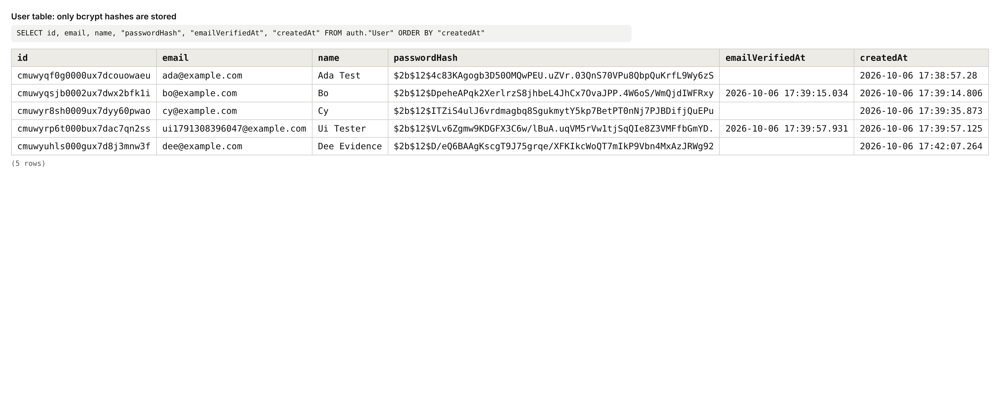
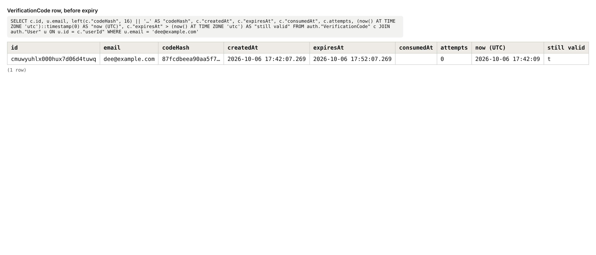

# Authentication Slice: Documentation

Assessment 1 of the Four Build Assessments. Stack: Next.js (App Router), TypeScript, Prisma, PostgreSQL.

---

## Section 1: What This Is

This is a complete email-and-password authentication system and nothing else. A new user creates an account, receives a 6-digit code by email, enters it, and lands on a placeholder dashboard. A returning user signs in. A user who forgets their password requests a link by email, sets a new password through it, and signs in with the new one. Signing out ends the session on the server, and typing the dashboard URL without a session sends you to sign in. Behind the six screens, passwords are hashed with bcrypt, every input is validated on the server by a schema the browser also uses, the abusable endpoints are rate limited, and codes and reset links expire in the database.

It deliberately has no landing page, no profile editing, no settings, no social sign-in and no two-factor authentication. The dashboard is one line of text and a sign out button. The brief asks for a single flow built properly, so every hour went into the parts being assessed: what happens when someone sends bad input, sends the same request twice, guesses a code, or hammers an endpoint.

---

## Section 2: How To Run It

**What to install:** Node.js 20.12 or newer (built and tested on 22) and a PostgreSQL database, either local or a free hosted one (Neon, Supabase).

1. Clone and install. `npm install` also generates the Prisma client.
   ```bash
   git clone https://github.com/daisydev11/auth-slice.git
   cd auth-slice
   npm install
   ```
2. Create your environment file and fill it in by hand.
   ```bash
   cp .env.example .env
   ```
   | Variable | Required | Where it comes from |
   |---|---|---|
   | `DATABASE_URL` | Yes | Your Postgres connection string. Keep `?schema=auth` on the end so the slice lives in its own schema. |
   | `APP_URL` | Yes | The address the app runs at. Locally: `http://localhost:3000`. Used to build the reset link. |
   | `RESEND_API_KEY` | No | From resend.com → API Keys. If left empty, emails are printed to the server terminal instead of sent. |
   | `EMAIL_FROM` | Only with a Resend key | A sender on a domain verified in Resend, or `onboarding@resend.dev` while testing. |
3. Create the tables.
   ```bash
   npx prisma migrate deploy
   ```
4. Start it.
   ```bash
   npm run dev
   ```
5. Open **http://localhost:3000**. You are redirected to `/signin`. Choose "Create an account".

With no `RESEND_API_KEY`, the verification code and the reset link appear in the terminal running `npm run dev`, on lines starting `[email:dev]`. That is the documented local equivalent of an inbox, so a reviewer can run the whole flow without an email account.

Tests: `npm test` (17 tests; the rate limiter tests use the database in `.env`).

---

## Section 3: The Flow, Step By Step

Every form uses the same hook, `src/components/auth/useApiForm.ts`. It validates in the browser with a schema from `src/lib/validation/auth.ts`, POSTs JSON to a route handler under `src/app/api/auth/`, and renders whatever the server answers. Every route handler starts with the same three steps: refuse cross-site requests, apply the rate limit, then parse the body against the same schema (`src/lib/http.ts`).

**1. Creating an account.** The user opens `/signup` (`src/app/signup/page.tsx`) and fills in name, email and password. When they leave a field, the hook checks it against `signupSchema` and shows the message under the input. On submit the frontend sends `POST /api/auth/signup` with `{ name, email, password }`. The server (`src/app/api/auth/signup/route.ts`) checks the rate limit for this IP, validates the body, hashes the password with bcrypt, and inserts the user. It then creates a 6-digit code, stores only its SHA-256 hash with an expiry 10 minutes ahead (`src/lib/auth/verification.ts`), and emails the code (`src/lib/auth/email.ts`). It answers `200 { ok: true, next: "verify" }` and the browser moves to `/verify?email=…`. No session exists yet.

**2. Verifying the email.** On `/verify` the user types the code. The frontend sends `POST /api/auth/verify` with `{ email, code }`. The server finds the user's newest code, rejects it if it is expired, already used, or has had 5 wrong guesses, and compares hashes. A wrong guess increments `attempts`. A correct one runs a transaction that marks the code consumed and sets `emailVerifiedAt` on the user. Then `createSession` in `src/lib/auth/session.ts` inserts a session row and sets the cookie, and the browser goes to `/dashboard`.

**3. Resending a code.** The "Resend code" button sends `POST /api/auth/resend` with `{ email }`. The server enforces two limits: 5 per 15 minutes per IP, and one code per 60 seconds per account. Inside the cooldown it answers `429` with a `Retry-After` header, and the button's countdown is set from that number. The countdown in the interface is only a mirror; the server refuses regardless.

**4. Reaching the dashboard.** `src/middleware.ts` runs first on `/dashboard` and redirects to `/signin` if there is no session cookie. Then `src/app/dashboard/page.tsx` calls `getSessionUser()`, which looks the cookie's hash up in the `Session` table with `expiresAt > now`. No matching live session means a redirect to `/signin`. Otherwise the page shows "Signed in as {name}" and a sign out button.

**5. Signing out.** The button sends `POST /api/auth/signout`. The server deletes the session row and then clears the cookie (`destroySession`). The browser goes to `/signin`. A copy of the old cookie no longer matches any row.

**6. Signing in.** On `/signin` the frontend sends `POST /api/auth/signin` with `{ email, password }`. The server applies a per-IP limit and a per-email limit, looks the user up, and always runs one bcrypt comparison, against a dummy hash if the email is unknown. A mismatch answers `401` with one message for both cases. A correct password on an unverified account answers `403 EMAIL_NOT_VERIFIED`, sends a fresh code if the cooldown allows, and the browser moves to `/verify`. Otherwise a session is created and the browser goes to `/dashboard`.

**7. Forgetting a password.** On `/forgot-password` the frontend sends `POST /api/auth/forgot-password` with `{ email }`. If the account exists, the server retires any earlier unused reset token, stores the SHA-256 of a new random token with a 30-minute expiry, and emails a link to `/reset-password?token=…`. The answer is `200 { ok: true }` whether or not the account exists, and the screen says "If an account exists…".

**8. Resetting the password.** The emailed link opens `/reset-password`, which passes the token to the form. The frontend sends `POST /api/auth/reset-password` with `{ token, password }`. In one transaction the server claims the token with an `UPDATE … WHERE usedAt IS NULL AND expiresAt > now`, and only if exactly one row changed does it store the new password hash and delete every session for that user. The browser goes to `/signin?reset=1`, and the user signs in with the new password. Using the same link again answers `400`.

---

## Section 4: The Data Model

Defined in `prisma/schema.prisma`; the SQL, including the check constraints, is in `prisma/migrations/20261006180000_init/migration.sql`.

```prisma
model User {
  id              String    @id @default(cuid())
  email           String    @unique
  name            String
  passwordHash    String
  emailVerifiedAt DateTime?
  createdAt       DateTime  @default(now())
}

model Session {
  id        String   @id @default(cuid())
  tokenHash String   @unique
  userId    String   // FK -> User, ON DELETE CASCADE
  expiresAt DateTime
  createdAt DateTime @default(now())
  @@index([userId])
}

model VerificationCode {
  id         String    @id @default(cuid())
  userId     String    // FK -> User, ON DELETE CASCADE
  codeHash   String
  expiresAt  DateTime
  consumedAt DateTime?
  attempts   Int       @default(0)
  createdAt  DateTime  @default(now())
  @@index([userId, createdAt])
}

model PasswordResetToken {
  id        String    @id @default(cuid())
  userId    String    // FK -> User, ON DELETE CASCADE
  tokenHash String    @unique
  expiresAt DateTime
  usedAt    DateTime?
  createdAt DateTime  @default(now())
  @@index([userId])
}

model RateLimit {
  key         String   @id
  count       Int
  windowStart DateTime
}
```

**User** holds one row per account.
- `email` is `NOT NULL` with a unique index. It is always stored lowercased, and a check constraint enforces that.
- `passwordHash` holds the bcrypt output. There is no password column, so there is nowhere for a plain password to be written by mistake.
- `emailVerifiedAt` is nullable on purpose: null means "not verified", and a timestamp records when. One column carries the state and the audit fact, where a boolean would carry only the state.

**Session** holds one row per signed-in browser.
- `tokenHash` is the SHA-256 of the cookie value, unique so a lookup returns at most one session. The raw token is never stored.
- `expiresAt` is `NOT NULL`: a session without an end is not allowed to exist.
- The index on `userId` serves "delete every session for this user", which runs on password reset.

**VerificationCode** holds one row per emailed code.
- `codeHash`, not the code, for the same reason as sessions.
- `expiresAt` is `NOT NULL` and is compared against the clock in the query that looks the code up.
- `consumedAt` is nullable: null means still usable. `attempts` counts wrong guesses so a code dies after 5.
- The `(userId, createdAt)` index serves the only read on this table: "newest code for this user".

**PasswordResetToken** holds one row per emailed reset link, with the same hashing and expiry pattern. `usedAt` is nullable and is what makes a token single use.

**RateLimit** holds one counter per action and identifier, for example `signin-ip:203.0.113.50`. `key` is the primary key because the limiter's atomic upsert needs a conflict target.

### Which constraints in this schema make an invalid state impossible?

| Constraint | The invalid state it rules out |
|---|---|
| `UNIQUE (User.email)` | Two accounts with one email, even when two signup requests arrive in the same millisecond and both pass an application-level "does it exist?" check. |
| `CHECK (email = lower(email))` on User | `Ada@x.com` and `ada@x.com` existing as two accounts because some future code path forgot to lowercase. |
| `NOT NULL` on `passwordHash` | An account with no credential, which a naive comparison might treat as "matches empty". |
| `UNIQUE (Session.tokenHash)`, `UNIQUE (PasswordResetToken.tokenHash)` | One cookie or one link resolving to two different users. |
| Foreign keys with `ON DELETE CASCADE` | A session, code or reset token that belongs to nobody, or that outlives a deleted user. |
| `NOT NULL` on every `expiresAt` | A session, code or token that never expires because someone forgot to set the field. |
| `CHECK (expiresAt > createdAt)` on Session, VerificationCode, PasswordResetToken | A record created already expired, or with a negative lifetime from a sign error in the arithmetic. |
| `CHECK (attempts >= 0)`, `CHECK (count >= 0)` | A counter driven negative, which would grant extra guesses or extra requests. |
| Primary key on `RateLimit.key` | Two counters for the same action and client, each letting the full allowance through. |

---

## Section 5: The Concepts

### Password Hashing

**What it is.** Hashing turns a password into a fixed-length string that cannot be turned back into the password. At sign-in I hash what was typed and compare it with what is stored. A password hash is also deliberately slow and salted, so the same password produces a different string for every user.

**Why it is needed.** If someone reads my `User` table, plain passwords would give them every account at once, and because people reuse passwords, accounts on other services too. With a slow salted hash, a stolen table is a list of strings that each cost real computing time to attack one guess at a time.

**How I implemented it.** bcrypt at cost 12, in `src/lib/auth/password.ts`, with the cost read from `src/lib/config.ts`. It runs at signup, at password reset, and for comparison at sign-in. On my machine cost 12 took about 323 ms per hash, cost 10 about 82 ms, and cost 4 about 4 ms.

```ts
export function hashPassword(plain: string): Promise<string> {
  return bcrypt.hash(plain, config.password.bcryptCost);
}
```

Sign-in also hashes when the email does not exist, against a dummy hash, so a missing account and a wrong password take the same time. Passwords over 72 characters are rejected by the schema, because bcrypt silently ignores everything after 72 bytes.

**What I chose against, and why.** SHA-256 is designed to be fast, which is exactly wrong here: fast for me is fast for an attacker testing billions of guesses. Argon2id is the stronger modern choice because it also costs memory, but it needs a native module to build on every machine and host, and I can explain bcrypt's single cost number precisely. I chose the one I can reason about and tune. I also chose against cost 10, the common default, because 82 ms is cheaper for an attacker than I need it to be for a user who signs in once.

### Rate Limiting

**What it is.** Rate limiting counts how many times one client has called an endpoint in a period and refuses further calls once a limit is reached. The refusal tells the client when it may try again.

**Why it is needed.** Without it, someone can send ten thousand sign-in attempts a minute and eventually guess a password, and each attempt costs me a database query and 323 ms of CPU for the hash. The resend endpoint is worse: each call sends an email I pay for, so one loop could empty a monthly email quota and get my sending domain flagged as spam. A 6-digit code has only a million possibilities, so unlimited guessing breaks verification outright.

**How I implemented it.** A fixed-window counter in Postgres, in `src/lib/auth/rate-limit.ts`, with all limits in `src/lib/config.ts`. One statement both increments and reads the counter:

```sql
INSERT INTO "RateLimit" AS r ("key", "count", "windowStart") VALUES ($key, 1, $now)
ON CONFLICT ("key") DO UPDATE SET
  "count" = CASE WHEN r."windowStart" <= $floor THEN 1 ELSE r."count" + 1 END,
  "windowStart" = CASE WHEN r."windowStart" <= $floor THEN $now ELSE r."windowStart" END
RETURNING "count", "windowStart"
```

Over the limit, the route returns `429 Too Many Requests` with a `Retry-After` header and the same number in the JSON body, which the form turns into a "Try again in Ns" button. Limits: signup 5 per 15 minutes per IP; sign-in 10 per 15 minutes per IP and 5 per email; password reset request 5 per IP and 3 per hour per email; resend 5 per IP plus one per 60 seconds per account; verify 20 per IP plus 5 wrong guesses per code.

**What I chose against, and why.** An in-memory counter (a `Map` in the server process) is the simplest version, but it resets on every deploy and, on serverless hosting, each instance would have its own count, so the real limit would be the limit times the number of instances. Redis is the standard answer and is faster, but it is a second piece of infrastructure to run for a slice that already has Postgres. I also chose against "read the count, then write count + 1" as two queries, because two requests arriving together would both read 4 and both pass; a test (`tests/rate-limit.test.ts`) fires 20 calls at once and asserts exactly 5 get through.

### Client-Side Versus Server-Side Validation

**What it is.** Client-side validation checks input in the browser before sending it, so the user sees a problem immediately. Server-side validation checks the same input again when it arrives, and is the only check that actually protects anything.

**Why it is needed.** The browser is under the user's control. Anyone can skip my form and send a request with curl, so a rule that exists only in the browser does not exist. Without server validation, a one-character password or a 10 MB "name" goes straight into my database. Without client validation, the system is still safe but the user has to submit and wait to learn about a typo.

**How I implemented it.** The rules are declared once, as Zod schemas in `src/lib/validation/auth.ts`. The route handler and the form import the same object:

```ts
// src/app/api/auth/signup/route.ts (server)
const body = await parseBody(request, signupSchema);
if (body.response) return body.response; // 422 with one message per field

// src/components/auth/SignupForm.tsx (browser)
const form = useApiForm({ schema: signupSchema, endpoint: "/api/auth/signup", ... });
```

A change to a rule changes both sides at once. The curl evidence at the end of this section shows the server rejecting input the browser form would never have sent.

**What I chose against, and why.** HTML attributes like `required` and `minlength` are free, but they are a second copy of the rules that can drift from the server's, and their messages differ per browser, so the forms use `noValidate` and the shared schema instead. I also chose against validating inside each handler with `if` statements: scattered checks are how one endpoint ends up forgetting the maximum length.

Some rules cannot be enforced on the client at all: whether an email is already registered, whether a code is correct or expired, whether a reset token is unused, and whether the caller is over a rate limit. Each depends on data only the server has.

### Session Management, And Why Sessions Rather Than Tokens

**What it is.** HTTP has no memory, so after sign-in the server has to recognise the same browser on the next request. A session is a row on the server saying "this random token belongs to this user until this time", with the token held by the browser in a cookie.

**Why it is needed.** Without it the user would send their password with every request. With a badly configured cookie, a script injected into the page could read the token and send it elsewhere, or another website could make the user's browser perform actions as them.

**How I implemented it.** `createSession` in `src/lib/auth/session.ts` is where a session begins. The cookie contains only 32 random bytes; the database stores their SHA-256.

```ts
(await cookies()).set(config.session.cookieName, token, {
  httpOnly: true,                                 // JavaScript cannot read it
  secure: process.env.NODE_ENV === "production",  // HTTPS only when deployed
  sameSite: "lax",                                // not sent on cross-site POSTs
  path: "/",
  expires: expiresAt,                             // 7 days, same as the row
});
```

Sign out deletes the row, so the session ends on the server and a copied cookie is worthless. A password reset deletes all of the user's rows.

**What I chose against, and why.** A JWT holds the user's identity inside the token itself, signed, so the server needs no lookup. The cost is that a JWT cannot be revoked before it expires without building a server-side blocklist, which is a session table with extra steps. "Sign out ends the session properly" and "reset signs you out everywhere" are requirements here, and with a session row each is a single `DELETE`. The price is one indexed query per authenticated request, which is cheap at this size. I also chose against storing the raw token in the database: with only the hash stored, a leaked `Session` table cannot be replayed as cookies.

### Token And Code Expiry, And Why Expiry Must Live In The Database

**What it is.** A verification code and a reset link are temporary credentials. Expiry is the rule that they stop working after a set time, and "living in the database" means the stored record carries its own deadline and the server checks it.

**Why it is needed.** If the only expiry is a countdown in the interface, it is decoration: the code in an old email still works next week for anyone who opens that inbox, and curl never sees the countdown at all. A reset link that never expires is a permanent second password sitting in someone's email.

**How I implemented it.** Each record has a `NOT NULL expiresAt`, and the deadline is part of the query. Password reset, in `src/app/api/auth/reset-password/route.ts`:

```ts
const claimed = await tx.passwordResetToken.updateMany({
  where: { tokenHash, usedAt: null, expiresAt: { gt: now } },
  data: { usedAt: now },
});
if (claimed.count !== 1) return false;
```

That one statement enforces "time limited" and "single use" together: an expired or used token matches zero rows. Verification codes work the same way in `src/lib/auth/verification.ts`, with a 10-minute lifetime, 5 wrong guesses, and only the newest code accepted. The evidence below shows the same code row before and after its deadline.

**What I chose against, and why.** Deleting records with a scheduled job when they expire also works, but then correctness depends on the job running on time, and the row is gone when I want to see what happened. I keep the row and let the comparison decide. I also chose against stateless signed links (the expiry inside the token, no table), because a signed link cannot be made single use without storing something anyway.

### Idempotency

**What it is.** An operation is idempotent if doing it twice leaves the system in the same state as doing it once. For signup that means two identical submissions produce one account, not two and not an error.

**Why it is needed.** Double submissions are normal: a double click, a retry after a slow response, a phone that resends when the connection drops. Without idempotency, the second request either creates a duplicate account or returns an alarming error for a signup that actually worked.

**How I implemented it.** In `src/app/api/auth/signup/route.ts` the insert is attempted directly, and the unique index on `email` decides the winner. The loser catches the constraint error and carries on as a repeat:

```ts
try {
  user = await db.user.create({ data: { name, email, passwordHash }, select: {...} });
} catch (error) {
  if (!(error instanceof Prisma.PrismaClientKnownRequestError && error.code === "P2002")) throw error;
  // already exists: load it and continue as a repeat submission
}
```

Both requests get the same `200`. The verification email is also sent once, because issuing a code goes through the same atomic limiter (one per 60 seconds per account). I tested it by firing two identical requests concurrently: one `User` row and one `VerificationCode` row.

**What I chose against, and why.** The obvious approach is "SELECT to see if the email exists, then INSERT if not". It fails in exactly the case the brief asks about: two requests in the same second both run the SELECT before either INSERT, and both proceed. I also chose against an `Idempotency-Key` header, which is the right tool when a request has no natural identity (a payment, for instance). A signup has one already: the email.

### Database Constraints As A Last Line Of Defence

**What it is.** A constraint is a rule the database itself enforces on every write, such as "this column is unique" or "this value references an existing row". It applies no matter which code, script or person performs the write.

**Why it is needed.** Application checks only cover the code paths I remembered to write them in. A race condition, a future endpoint, a migration script or a manual fix in a database console all bypass them. Without the unique index, the double-signup race creates two accounts for one email, and from then on sign-in for that email is undefined.

**How I implemented it.** Unique indexes, foreign keys with cascade, and `NOT NULL` come from `prisma/schema.prisma`. Prisma's schema language cannot express check constraints, so I added those by hand in the migration SQL:

```sql
ALTER TABLE "User" ADD CONSTRAINT "User_email_lowercase_check"
  CHECK ("email" = lower("email"));
ALTER TABLE "VerificationCode" ADD CONSTRAINT "VerificationCode_expiry_check"
  CHECK ("expiresAt" > "createdAt");
```

The table in Section 4 lists each constraint and the state it prevents. The signup route depends on one of them directly: its idempotency is the unique index.

**What I chose against, and why.** I could have relied on Zod alone, since it already lowercases emails and bounds every field. But validation describes what the API accepts, while constraints describe what the data is allowed to be, and only the second holds when the API is not the thing writing. I also chose against Postgres's case-insensitive `citext` type for email: it needs an extension enabled on the database, and a lowercase check does the same job with nothing to install.

### Protected Routes

**What it is.** A protected route is a page or endpoint that only responds to a signed-in user. Everyone else is sent to sign in before any of its content is produced.

**Why it is needed.** Hiding the link to the dashboard is not protection; anyone can type the URL. Without a server-side check, the page renders for anybody, and in a real product that page would hold the user's data.

**How I implemented it.** Two layers. `src/middleware.ts` runs before the route and redirects any request to `/dashboard` that carries no session cookie. Then the page itself validates that cookie against the database:

```ts
// src/app/dashboard/page.tsx
const user = await getSessionUser();
if (!user) redirect("/signin");
```

The second check is the real one. A forged cookie (`Cookie: session=forged`) passes the middleware and is refused by the page, which I tested with curl: `307 → /signin`. After sign out, the same test with the real old cookie also returns `307 → /signin`.

**What I chose against, and why.** Middleware alone would be less code, but it only knows that a cookie exists, not that it is valid; this middleware does not query the database. A client-side check (render the page, then redirect in a `useEffect` if there is no user) is the common mistake: the protected content has already been sent to the browser by the time the redirect runs.

### Evidence

All of the following was produced by running this repository's code against a real PostgreSQL database.

**1. The users table stores hashes only.** Every `passwordHash` begins `$2b$12$`: bcrypt, cost 12. There is no column that could hold a plain password.



**2. Hitting signup directly with curl, bypassing the browser.** The form would have blocked this input before sending. The server rejects it on its own:

```bash
curl -i -X POST http://localhost:3000/api/auth/signup \
  -H "Content-Type: application/json" \
  -d '{"name":"","email":"not-an-email","password":"short"}'
```
```
HTTP/1.1 422 Unprocessable Entity
content-type: application/json

{"error":{"code":"VALIDATION_FAILED","message":"Some fields need attention.","fields":{"name":"Enter your name.","email":"Enter a valid email address.","password":"Use at least 8 characters."}}}
```

A request the browser could never build, with a missing field and a number where a string belongs:

```bash
curl -i -X POST http://localhost:3000/api/auth/signup \
  -H "Content-Type: application/json" \
  -d '{"email":"eve@example.com","password":12345678}'
```
```
HTTP/1.1 422 Unprocessable Entity

{"error":{"code":"VALIDATION_FAILED","message":"Some fields need attention.","fields":{"name":"Enter your name.","password":"Enter a password."}}}
```

**3. The rate limit triggering.** Seven signup requests from one address. The limit is 5 per 15 minutes; requests 6 and 7 are refused before validation even runs:

```
request 1 -> HTTP 422
request 2 -> HTTP 422
request 3 -> HTTP 422
request 4 -> HTTP 422
request 5 -> HTTP 422
request 6 -> HTTP 429
request 7 -> HTTP 429
```
```
HTTP/1.1 429 Too Many Requests
retry-after: 900

{"error":{"code":"RATE_LIMITED","message":"Too many attempts. Try again in 900 seconds.","retryAfterSeconds":900}}
```

The resend cooldown, called 13 seconds after a code was issued:

```
HTTP/1.1 429 Too Many Requests
retry-after: 47

{"error":{"code":"RATE_LIMITED","message":"Too many attempts. Try again in 47 seconds.","retryAfterSeconds":47}}
```

**4. A verification code in the database, and the same record after expiry.**

Before, with 10 minutes to live:



EXPIRY_AFTER_PLACEHOLDER

---

## Section 6: What Went Wrong

### 1. Prisma could not download its engine

- **The symptom.** The first `npx prisma migrate dev` failed with `Failed to fetch sha256 checksum at https://binaries.prisma.sh/... - 403 Forbidden`.
- **The investigation.** The error suggested setting `PRISMA_ENGINES_CHECKSUM_IGNORE_MISSING=1`, which turned out to be irrelevant: the checksum was not the problem, the whole host was refused by the network I was building on, so the engine binary itself could not be fetched either. I checked whether the binaries had arrived with `npm install` (`node_modules/@prisma/engines` held no binary). I then pointed `PRISMA_SCHEMA_ENGINE_BINARY` at a local file to skip that download, and the failure simply moved on to the next file, `libquery_engine.so.node`.
- **The cause.** Prisma's default client runs queries through a Rust engine downloaded from `binaries.prisma.sh` at install time, and that host was blocked. Nothing in the code was wrong.
- **The fix.** I switched the client to Prisma's engine-free mode: `engineType = "client"` in `prisma/schema.prisma` plus the `@prisma/adapter-pg` driver adapter in `src/lib/db.ts`, so queries go through the `pg` driver and no binary is needed at runtime. The migration SQL in `prisma/migrations/` was written to match the schema and applied with `psql` on that machine; on an unrestricted network `npx prisma migrate deploy` applies the same file.

### 2. Every query failed with "table public.User does not exist"

- **The symptom.** With the driver adapter in place, a query through a client built from just the connection string returned `P2021: The table public.User does not exist in the current database`.
- **The investigation.** The tables did exist; `\dt auth.*` in `psql` listed all five. The connection string was right and still ended in `?schema=auth`. So the client was connecting to the correct database and looking in the wrong schema.
- **The cause.** `?schema=` is a Prisma convention, not a Postgres one. The Rust engine used to read it; the `pg` driver ignores it, so the client fell back to `public`.
- **The fix.** `src/lib/db.ts` now reads the `schema` parameter from the URL itself and passes it to the adapter (`new PrismaPg({ connectionString }, { schema })`). The rate limiter's raw SQL uses the same value to qualify its table name, since raw queries get no schema help from Prisma.

### 3. The server leaked a raw validator message

- **The symptom.** While collecting the curl evidence I sent `"password": 12345678` (a number). The response said `"password":"Expected string, received number"`.
- **The investigation.** Every message I had written was in the schemas, and this was not one of them. The browser tests had not shown it, and could not: an HTML input always sends a string, so only a hand-built request reaches this path. I had set `required_error` on each field, which covers a missing value but not a wrong type.
- **The cause.** Zod has a separate `invalid_type_error`, and I had left it at the library default.
- **The fix.** A small `text(message)` helper in `src/lib/validation/auth.ts` sets both errors to the same human message, and every string field uses it. A test in `tests/validation.test.ts` now sends a number and asserts the message.

### 4. An empty password got the wrong message

- **The symptom.** Submitting the empty signup form in a real browser showed "Enter your name.", "Enter your email address." and then "Use at least 8 characters." for the password.
- **The investigation.** I first assumed the `required_error` was not firing. It was not supposed to: an empty input sends `""`, which is a present string, so "required" never applies.
- **The cause.** The first rule an empty string broke was the minimum length, so that was the message shown.
- **The fix.** Added `.min(1, "Enter a password.")` ahead of the length rule, matching how the name and email fields already behaved.

---

## Section 7: What This Slice Does Not Handle

**Left out because it is outside the brief**
- Social sign-in, two-factor authentication, profile editing, settings, account deletion, changing email.
- A list of active sessions or "sign out other devices" (a reset does sign out everywhere).

**Left out because I ran out of time**
- **Rate limit rows are never cleaned up.** Every distinct IP and email creates a `RateLimit` row that stays forever. It needs a scheduled delete of rows older than the longest window.
- **Expired sessions, codes and tokens are never deleted** either. They are harmless, since every query checks expiry, but the tables only grow.
- **End-to-end tests are not in the repository.** I ran every flow in a real browser and with curl while building, but the committed tests cover validation, hashing, tokens and the rate limiter only.
- **No breached-password check.** `password1` passes the rules.

**What I would need to add before real users touched it**
- **A trustworthy client IP.** The limiter keys on the first `X-Forwarded-For` value. That is correct behind a host that sets the header, but on a server exposed directly, a caller can send a different value on every request and dodge the per-IP limits. The per-email limits and the per-code attempt cap still hold.
- **Protection for pre-registered emails.** If someone signs up with your address and never verifies, your later signup replaces their password and sends you a code. But if they then submit again while you are mid-flow, the newest submission wins. Binding each code to the submission that created it would close this.
- **Email delivery failures.** If the provider rejects a message, the request fails with a 500 and the 60-second cooldown has already been spent. It needs a queue with retries.
- **Account lockout messaging and alerts.** A user whose email is being attacked hits the per-email limit themselves, with no email telling them why.

**What breaks at scale**
- The fixed window allows a burst of up to twice the limit across a window boundary. A sliding window fixes that.
- Rate limiting in Postgres adds a write to every auth request. At high volume this belongs in Redis.
- Each authenticated page load costs one session query. That is fine here and would want a short cache with many pages per user.

---

## Section 8: If I Built This Again

I would write the browser tests first and keep them in the repository. The two validation bugs in Section 6 were both found late, one by a browser run and one by curl, and both existed from the first version of the schema file because my early checks were type-checking and reading the code, which cannot tell you what message an empty field actually produces. An automated run of each screen, plus a handful of hostile requests against each endpoint, written before the forms existed, would have caught both within minutes and would now be guarding every rule in this document against the next change. As it stands, the proof that the flows work is evidence I gathered by hand, and it goes stale the moment the code changes.
